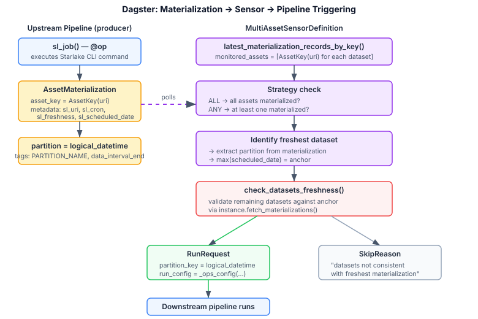
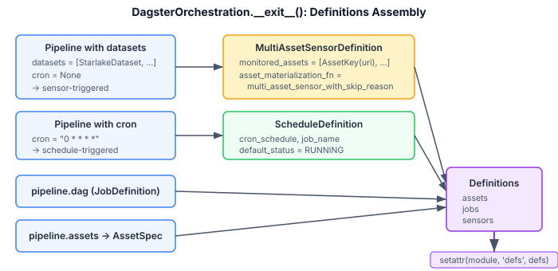
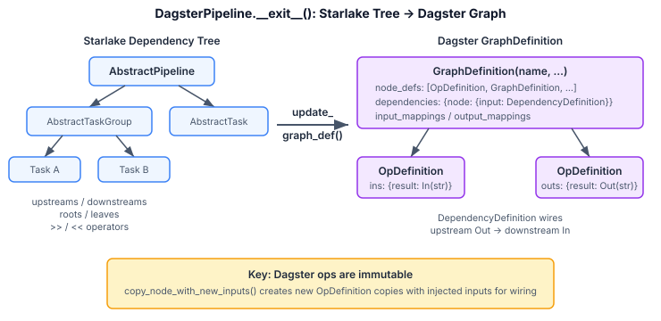

# Starlake Dagster — Architecture Reference

This document describes the internal architecture of the `starlake-dagster` module. It is intended for contributors, AI agents, and anyone extending the framework.

For usage documentation, see [README.md](README.md).
For core module architecture, see [starlake-orchestration/ARCHITECTURE.md](../starlake-orchestration/ARCHITECTURE.md).

## Role Within the Framework

The Dagster module concretizes the core `starlake-orchestration` abstractions for Dagster:

| TypeVar | Dagster Concrete Type |
|---------|----------------------|
| `U` (pipeline) | `JobDefinition` |
| `T` (task) | `NodeDefinition` (concretely `OpDefinition`) |
| `GT` (task group) | `GraphDefinition` |
| `E` (event) | `AssetKey` |

## Package Structure

```
ai.starlake.dagster/
├── starlake_dagster_job.py             StarlakeDagsterJob, DagsterDataset, StarlakeDagsterUtils,
│                                       DagsterLogicalDatetimeConfig
├── starlake_dagster_orchestration.py   DagsterOrchestration, DagsterPipeline
├── shell/
│   └── starlake_dagster_shell_job.py   StarlakeDagsterShellJob
├── gcp/
│   ├── starlake_dagster_cloud_run_job.py   StarlakeDagsterCloudRunJob
│   └── starlake_dagster_dataproc_job.py    StarlakeDagsterDataprocJob
└── aws/
    └── starlake_dagster_fargate_job.py     StarlakeDagsterFargateJob
```

## Key Architectural Difference from Airflow

In Airflow, tasks auto-register with the current DAG context and dependencies are wired via `set_upstream()`. In Dagster, the dependency graph must be **explicitly constructed** as a `GraphDefinition` with `node_defs`, `dependencies` (`DependencyDefinition` dict), `input_mappings`, and `output_mappings`. Additionally, Dagster ops are **immutable** — adding inputs requires creating a new `OpDefinition` copy.

This means `DagsterPipeline.__exit__()` must walk the entire Starlake dependency tree and translate it into Dagster's declarative graph model — a heavier transformation than Airflow's `set_upstream()` calls.

## Asset Materialization & Sensor-Driven Triggering

This is the central mechanism for data-aware pipeline scheduling in Dagster. Unlike Airflow where `start_op()` queries the DB at runtime inside a `ShortCircuitOperator`, Dagster uses a **sensor** that polls materialization records externally and decides whether to submit a `RunRequest`.



### How It Works

**1. Upstream pipeline produces materializations**

Each execution environment's `sl_job()` creates an `@op` that, on success, yields:
- `AssetMaterialization(asset_key=AssetKey(uri))` with metadata: `sl_uri`, `sl_cron`, `sl_freshness`, `sl_scheduled_date`, `sl_dry_run`, and (when present) `sl_options` (see [Runtime options propagation](#runtime-options-propagation-sl_options))
- The materialization is tagged with `partition = logical_datetime` (the scheduled date formatted as `sl_timestamp_format`)

The `StarlakeDagsterUtils.get_materialization()` method builds these materializations with full metadata and partition tags, including `PARTITION_NAME_TAG` and `data_interval_end`.

**2. Sensor monitors upstream assets**

In `DagsterOrchestration.__exit__()`, for each pipeline with datasets, a `MultiAssetSensorDefinition` is created:
- `monitored_assets` = `[AssetKey(uri) for each dataset]`
- `minimum_interval_seconds` = 60
- `asset_materialization_fn` = `multi_asset_sensor_with_skip_reason`

**3. Sensor evaluation logic** (`multi_asset_sensor_with_skip_reason`)

The sensor function runs on each evaluation cycle:

1. **Retrieve latest materializations** via `context.latest_materialization_records_by_key()`
2. **Strategy gate**: check `DatasetTriggeringStrategy.ANY` (at least one materialized) or `.ALL` (all materialized). If not met → `SkipReason`
3. **Extract partition dates** from materialization records via `get_dataset_and_partition()` — reads `partition_key`, `tags`, or `metadata[sl_scheduled_date]`
4. **Identify anchor**: find the materialized dataset with the **greatest scheduled date** (`max(materialized_schedules)`)
5. **Build checking set**: remaining datasets = not-materialized + older-materialized (excluding the anchor)
6. **Validate freshness** via `check_datasets_freshness()` (detailed below)
7. **Merge triggering options**: `StarlakeDagsterUtils.collect_sl_options_with_merge()` merges the `sl_options` sections carried by the triggering materializations (fail-loud, or by union for the keys declared so — see [Runtime options propagation](#runtime-options-propagation-sl_options)). When the check passes, the materializations it accepted from the event log for the datasets without an unconsumed materialization are merged in as well (since 0.5.11, issue #168), so a union declaration carried by one of them also resolves a conflict among the triggering materializations, as on Airflow; any other conflict fails the tick, whatever the check's verdict
8. **Result**:
   - All consistent → `RunRequest(run_config=_ops_config(logical_datetime, previous_logical_datetime, sl_options), partition_key=logical_datetime, tags={...})` + `context.advance_cursor()`
   - Missing/inconsistent → `SkipReason`

**ANY vs ALL — trigger gate vs post-gate consistency check**

The `dataset_triggering_strategy` option governs the **trigger gate only** (step 2). Passing the gate does not fire a run by itself: a **designed post-gate consistency check** (steps 4–6) then requires the freshness of **all** the non-optional datasets the pipeline depends on within the window frame before a `RunRequest` is emitted. Under `ANY` with a partially-materialized upstream set, the sensor therefore keeps skipping — it does **not** fire on the first available upstream the way Airflow's `DatasetAny`/`AssetAny` timetable does. Users porting event-driven pipelines from Airflow should expect this difference (intentional design — see issue [#78](https://github.com/starlake-ai/starlake-orchestration/issues/78); behavior pinned by `tests/dagster/test_dagster_triggering_strategy.py`).

Observed sensor outcomes:

| strategy | materialized | outcome |
|----------|--------------|---------|
| `ANY` | 1 of 2 | `SkipReason("Observed materializations for ..., but not for ...")` — post-gate consistency check |
| `ALL` | 1 of 2 | `SkipReason("No materializations observed")` — trigger gate |
| `ANY`/`ALL` | 2 of 2 | `RunRequest` |

**4. `check_datasets_freshness()` — Validation Engine**

This is the Dagster equivalent of Airflow's `check_datasets()`. Same logical phases but uses **Dagster's public API** (no direct DB access):

| Step | Method | API Used |
|------|--------|----------|
| Find previous successful partition | `get_previous_partition()` | `instance.get_runs(RunsFilter(job_name, statuses=[SUCCESS]))` |
| Retrieve materialization events | `find_dataset_events()` | `instance.fetch_materializations(AssetRecordsFilter)` |
| Retrieve the materializations of a data-cycle window | `find_dataset_events_in_window()` | `instance.fetch_materializations(AssetRecordsFilter)`, twice |
| Extract partition from event | `get_event_partition()` | `event.partition_key` or `event.asset_materialization.metadata` |

The anchor (`scheduled_date`) is the greatest scheduled date among the unconsumed materializations (step 4 above). Per-dataset validation follows the same pattern as Airflow:
- **Data-cycle mode** (since 0.5.11, only with a **declared** data cycle, issue #167): a dataset with a cron of its own that fires at least once in **every** period of the data cycle delivers its data over the period, its ticks being attempts of one delivery (e.g. `0 6 1-3 * *`, a monthly delivery whose files arrive on any of the first three days, in a pipeline with `data_cycle: monthly`), or one delivery per period (a monthly table `0 6 2 * *` in the same pipeline). The job decides (`job.data_cycle_mode(cron)`, starlake-orchestration): the data cycle must be declared by the `data_cycle` option with `data_cycle_enabled` (`data_cycle_declared`), and `fires_in_every_period(cron, data_cycle)` compares the crons over a fixed reference span, so the result never depends on the wall clock. Such a dataset is checked in the window `(start of the data-cycle period that holds the anchor, anchor]` (`data_cycle_window(data_cycle, scheduled_date)`): the period start is the latest data-cycle tick strictly before the anchor, so an anchor exactly on a tick belongs to the period that ends there, and freshness widens the window on neither side (the lower bound never reaches the previous period, and no unconsumed materialization exceeds the anchor). Neither *optional* nor *beyond-data-cycle* applies to it. With `data_cycle: monthly` (`0 0 1 * *`) and `0 6 1-3 * *` dependencies, a run anchored on 2 December 06:00 admits `(1 December 00:00, 2 December 06:00]` (an attempt of 1 December is accepted, whether it is still unconsumed or already in the event log), a run anchored on 1 December 06:00 admits `(1 December 00:00, 1 December 06:00]` (the delivery of 2 November is refused), and a reloaded October file anchors the run on 2 October, so the other table's October materialization is accepted (one table catching up under the `any` strategy). Its event-log lookup is **not restricted to the two boundary partitions** of a tick-by-tick window, since an earlier attempt lies on any tick of the period: `find_dataset_events_in_window()` merges the materializations partitioned on the dataset's ticks within the window (the most recent `DATA_CYCLE_PARTITIONS_LIMIT` = 500 of them; a scheduled load is partitioned on its tick, and this lookup is not crowded out by the materializations recorded after it) with its latest `limit` materializations without partition filter (a manual or replayed load partitioned off its ticks), keeps those whose scheduled date (`get_event_partition()`) lies in the window, and the check accepts the most recently recorded one.
- **Dataset mode** — any other dataset (one that misses a period, e.g. a yearly table in a monthly pipeline, which keeps its own window and does not block the pipeline; one that fires only on the cycle ticks (`0 0 1 * *` in a monthly cycle, or the declared cycle itself: an event dated on a tick closes the period that ends there, so it would never fall in the window of an anchor that follows the tick)), and every dataset without `data_cycle_enabled` or when the data cycle is the default one (the pipeline's computed cron, which carries the hour of one dependency's cron and delimits no delivery: daily loads at 06:00 and 07:00 would otherwise refuse each other's materializations of the same day), unchanged:
  - Compute `(min, max)` window from `scheduled_dates_range(cron, scheduled_date)`, its upper bound raised to the anchor
  - **Optional datasets**: skip if frequency > data_cycle frequency
  - **Beyond-data-cycle**: extend window by ±freshness seconds
  - Both comparisons use `get_cron_frequency`, which measures the gap between the next two ticks from the wall clock, so for monthly crons their outcome can change with the month the check runs in; the data-cycle mode removes this for the datasets it covers
  - The event-log lookup of a dataset with a cron of its own only fetches the materializations partitioned on the two boundary ticks of its window (before the widening)
- **Scheduled datasets**: check triggering partition in window, then query historical materializations
- **Non-scheduled datasets**: check materializations between `previous_partition - freshness` and `scheduled_date + freshness`

**Behaviour change** (0.5.11, issue #167): a pipeline that already declares `data_cycle` with `data_cycle_enabled` sees its dependencies that fire in every period checked in the cycle window, looked up on every tick of it, without freshness widening. A dependency more frequent than the cycle is satisfied by any of its events since the start of the period (a daily table in a monthly cycle accepts its event of the 1st on the 20th). Since issue #166, the load materializations publish the freshness of their table: on an unconsumed materialization it now wins over the consumer's declaration (`parameters.get(FRESHNESS) or self.get_freshness(mat) or dataset.freshness`; the published 0 used to count as absent). The values match for generated DAGs; a hand-written consumer declaring a larger freshness gets a narrower window. The checks accept the latest in-window materialization of a dependency (`find_dataset_events` returns the most recent last), the oldest one before.

Returns a `DatasetsFreshnessCheck` named tuple `(checked, previous_partition, max_scheduled_date, missing, accepted)` (positional access still works; before 0.5.11 a 4-tuple, and `False` when the pipeline had neither a previous successful run nor a start date before the anchor, which the sensor could not read: that case now returns `checked=False` with every dataset missing). `accepted` holds, when the check passes, the materialization (`EventLogRecord`) accepted from the event log for each dataset that is not in `triggering_uris` (the datasets whose unconsumed materializations the sensor relays itself, by default the keys of `schedules`), whatever its lookup (scheduled, data-cycle or non-scheduled) — see [Runtime options propagation](#runtime-options-propagation-sl_options).

### Partition Date Encoding

Dagster partition keys cannot contain `:` or `+`, so `StarlakeDagsterUtils` provides encoding:
- `quote_datetime()`: `2026-03-23T14:30:00+00:00` → `2026-03-23T14.30.00_00.00`
- `unquote_datetime()`: reverses the encoding

## Runtime options propagation (sl_options)

Producer pipelines can carry runtime `starlake --options` variables to the downstream pipelines their materializations trigger. This is the Dagster counterpart of the Airflow mechanism (Dataset/Asset event `extra` + `sl_options_from_events` macro — see [starlake-airflow/ARCHITECTURE.md](../starlake-airflow/ARCHITECTURE.md)); here the carrier is **materialization metadata** and the relay is the **sensor**, since Dagster ops read config instead of Jinja-templated context.

The payload is a JSON dict of sections under `StarlakeParameters.OPTIONS_PARAMETER` (`sl_options`): `{"all": {key: value}, "<domain.task>": {key: value}}` — the `all` section applies to every node of the triggered run, a task-keyed section only to that node.

**1. Publish — `StarlakeDagsterUtils.get_materialization()`**

When building an `AssetMaterialization`, two sources are merged into a `MetadataValue.json` entry under `sl_options`:
- **static sections** passed by the caller through the `extra` kwarg of `sl_job()` (declared on the job, analogous to the Airflow mixin's `extra` template field)
- **run-level sections** from `config.sl_options`, overriding the static ones — so a run *relays* the options it was itself triggered with (multi-hop propagation across pipeline chains)

The merge declarations of the keys (`StarlakeParameters.OPTIONS_MERGE_PARAMETER`, `sl_options_merge`: `{"all": {key: {"policy": "union", "separator": "|"}}}`, issue #158) are published the same way, from `extra` and from `config.sl_options_merge`, under a `sl_options_merge` metadata entry — so a relayed set of values keeps merging by union downstream.

**2. Relay — the pipeline sensor**

`multi_asset_sensor_with_skip_reason` calls `StarlakeDagsterUtils.collect_sl_options_with_merge()` on the triggering materializations — the latest one of each monitored asset, plus, when one of them carries merge declarations, the earlier unconsumed ones (`superseded_materializations()`, at most `SUPERSEDED_MATERIALIZATIONS_LIMIT` per asset) so that a producer that ran several times since the consumer's last run contributes every run to a union, while any other key keeps the latest run's value — which merges them with the core `merge_sl_options` (rules in [starlake-orchestration/ARCHITECTURE.md](../starlake-orchestration/ARCHITECTURE.md#merge-of-coalesced-run-variables-aistarlakesl_options-issue-158)). Merging is **fail-loud**: the same key carried with different values by two materializations raises, failing the sensor tick — conflicting run variables must stop the run, not silently pick one (the recovery escape hatch is launching the runs one by one, passing `sl_options` in the run config manually) — unless a producer declared the key `union`: its values then merge into their sorted, de-duplicated union. The merged sections and their declarations are JSON-encoded and injected into every op of the `RunRequest` via `_ops_config(..., sl_options=..., sl_options_merge=...)` (`DagsterLogicalDatetimeConfig.sl_options` / `sl_options_merge`). With a union, one run may rebuild the values of several producer runs: the consumer must be idempotent per value and guard against values a later producer run rejected.

**Materializations accepted by the check** — the sensor relays the materializations it has not consumed yet, while `check_datasets_freshness()` may accept, for a dataset without an unconsumed materialization, a materialization it looks up in the event log, already consumed by an earlier tick. Under the `ANY` triggering strategy the run of the last load of a delivery to arrive passes the check thanks to the materializations it finds for the others: with daily loads of `finance.balances` at 06:00 and `finance.contracts` at 07:00, each publishing the business date it loaded (`balances_file_date`, `contracts_file_date`), the tick after contracts' load used to request a run with `contracts_file_date` only, and a transformation reading `{{balances_file_date}}` failed. Since 0.5.11 (issue #168), the check returns these materializations (`DatasetsFreshnessCheck.accepted`, for the datasets outside `triggering_uris`, i.e. without an unconsumed materialization), and when it passes, the sensor merges their `sl_options` / `sl_options_merge` with the triggering ones: `collect_sl_options_with_merge(..., accepted=...)`, under the same rules — the same key with different values fails loud, a union declaration carried by either side applies to both (when an accepted materialization declares one, the earlier unconsumed materializations of the triggering assets are read for it too), two different declarations fail, and a malformed declaration fails, naming the materialization. An accepted materialization takes part only when its sections carry at least one key or it carries a merge declaration, so a run whose accepted materializations carry no run variables gets the same run config as before. A conflict among the triggering materializations alone keeps its message (run them one by one); a conflict that involves an accepted materialization names it (`finance_balances (materialization 42 accepted by the sensor)`, 42 being its storage id) and asks instead to launch the run manually, passing `sl_options` in the run config: nothing was coalesced, the sensor would accept the same materialization again, and a manual run skips the check, so it relays nothing. The ops still read the merged sections from `DagsterLogicalDatetimeConfig.sl_options`.

Behaviour changes (0.5.11, issue #168):

- a tick can now fail when a triggering materialization and an accepted one carry the same key, not declared `union`, with different values (e.g. both loads publish `file_date`): before 0.5.11 the run silently received the triggering materialization's value;
- an accepted materialization's value now overrides a static transform option of the same name, since the run variables are appended last to `--options`;
- a malformed `sl_options_merge` on the materialization of a producer without an unconsumed materialization now fails the tick, as it does on a triggering materialization;
- a dataset whose lookup window covers several consumer runs relays the same materialization to each of them: with a weekly B and a daily A, every daily run of the week accepts B's weekly materialization, and a `union` key of B (e.g. `b_file_dates`) is reprocessed by each of these runs, so the transformation must be idempotent per value.

A dataset whose unconsumed materialization falls outside its window and whose lookup accepts another materialization contributes only its unconsumed materialization's run variables: relaying the accepted one as well would make the strict merge fail every run where the two materializations of the same dataset (two deliveries) carry different values of the same key. Residual case: when the unconsumed materialization is a replay that carries a different key set than the regular load and the check accepts the regular in-window materialization, a variable that only the accepted one carries does not reach the ops; the recovery is a manual run with `sl_options` in the run config.

**3. Consume — `StarlakeDagsterUtils.get_sl_options()`**

At op runtime, each execution environment resolves the options applying to its node: `config.sl_options` (falling back to the run tag), merging the `all` section with the section keyed by the node name. The result is appended **last** to the command's `--options` — starlake keeps the last occurrence of a duplicate key, giving precedence `static options < "all" < task-specific`.

**Quoting**: in the shell job, the `--options` value is wrapped in double quotes just before the command string is joined (after the transform branch has split/merged the value on commas), so values containing spaces survive shell word splitting (#51).

## Pre-load Not-Ready Sentinel Verdict Seams (story 6.12, issue #122)

The opt-in `pre_load_not_ready_sentinel_path` option (CLI ≥ 1.5.15, `--notReadySentinel`) plugs a **verdict channel** into the existing op composition — the forced `skip_or_start` optional-output skip and the 6.2/6.7 in-op wall-clock poke loops. Three shared seams on `StarlakeDagsterJob`:

- `_sl_resolve_sentinel(kwargs, allowed_schemes, engine)` — pops `sentinel_path` unconditionally BEFORE the `Out`/`RetryPolicy` computation (6.2 rule) and gates the scheme at definition time (local for shell, `gs://` for cloud_run/dataproc, `s3://` for fargate);
- `_sl_sentinel_substitute_args(arguments, context)` — run-time `<job_name>__<run_id>` scope substitution over a **per-attempt copy** of the command vector (the closure `arguments` list is never mutated — the #111/#115 closure-hygiene rule; the token is the literal `__SL_SENTINEL_SCOPE__`, never a template);
- `_sl_sentinel_ready(context, sentinel_path)` — consume-then-signal (delete FIRST) via the core `default_sentinel_handlers` (local stdlib for shell, `ai.starlake.gcp`/`ai.starlake.aws` lazy-SDK factories for `gs://`/`s3://` — no handler code duplicated in this module).

Verdict wiring in each variant's op body, only when the option is set: a failed run raises `Failure` immediately (fail-fast — 'not ready' ends success in sentinel mode, so the `skip_or_start` swallow and the poke-until-timeout trade-off no longer apply); success + marker → consume → bare return (one-shot optional-output skip) or poke-again (loop, `is_success` = the consumed verdict); success + no marker → READY. Dataproc reads "success" as the DONE terminal state.

## Definitions Assembly



`DagsterOrchestration.__exit__()` assembles all Dagster definitions and dynamically binds them to the caller's module via `setattr(module, 'defs', defs)`. This is how Dagster discovers the definitions when loading the module.

For cron-scheduled pipelines, a `ScheduleDefinition` is created instead of a sensor. Both paths produce a `JobDefinition` from the pipeline's graph.

## Graph Construction



`DagsterPipeline.__exit__()` calls `update_graph_def()` recursively to transform the Starlake dependency tree into Dagster's `GraphDefinition`:

1. **Walk roots downstream** via `walk_downstream()`: for each upstream → downstream pair, create `DependencyDefinition` entries that wire the upstream's `Out` to the downstream's `In`
2. **Handle task groups**: for `AbstractTaskGroup` nodes, recurse into the group and create `InputMapping` / `OutputMapping` to connect the group's boundary nodes
3. **Inject inputs**: since Dagster ops are immutable, `copy_node_with_new_inputs()` creates new `OpDefinition` copies with the additional inputs needed for wiring
4. **Build output mappings**: leaf nodes' outputs are exposed as the graph's outputs via `OutputMapping`
5. **Create `GraphDefinition`** with `node_defs`, `dependencies`, `input_mappings`, `output_mappings`

After graph construction, if the pipeline has a cron schedule, a `PartitionedConfig` with `TimeWindowPartitionsDefinition` is created to enable time-partitioned execution. The final `JobDefinition` is created with the graph and optional partition config.

## Class Reference

### Event & Utility Layer

#### `DagsterDataset` (extends `AbstractEvent[AssetKey]`)

`to_event(dataset)` → `AssetKey(dataset.uri)`. Simple key — metadata is carried by `AssetMaterialization`, not the key itself.

#### `DagsterLogicalDatetimeConfig` (extends `dagster.Config`)

Run configuration schema injected into every `@op`: `logical_datetime` (str), `previous_logical_datetime` (optional str), `dry_run` (bool, default False), `sl_options` (optional str — JSON-encoded runtime options sections, populated by the pipeline sensor's `RunRequest` or manually at launch), `sl_options_merge` (optional str — JSON-encoded merge declarations of those options, relayed with them; see [Runtime options propagation](#runtime-options-propagation-sl_options)).

#### `StarlakeDagsterUtils`

Static utilities — replaces Airflow's Jinja2 macros with explicit runtime calls:
- `get_logical_datetime(context, config)` — resolves from: partition key → config → run launch time → now
- `get_materialization(context, config, dataset)` — builds `AssetMaterialization` with full metadata (including the merged `sl_options` sections) and partition tags
- `get_transform_options(context, config, params)` — computes `sl_data_interval_start` / `sl_data_interval_end`
- `collect_sl_options(materializations)` — fail-loud merge of the `sl_options` sections carried by triggering materializations, by union for the keys declared so
- `collect_sl_options_with_merge(materializations, superseded=(), accepted=())` — the same, also returning the merge declarations of the keys (used by the pipeline sensor, which relays them); the `superseded` materializations add their values to the keys declared union only; the `accepted` event-log records (materializations accepted by the sensor's check, issue #168) are merged under the same rules when they carry run variables, with their own error label and recovery
- `superseded_materializations(context, latest_records, accepted=())` — the earlier unconsumed materializations of each triggering asset, read only when a latest one, or an accepted one, carries merge declarations
- `get_sl_options(context, config, name)` — resolves the runtime options applying to a node (`all` section + node-keyed section) from `config.sl_options` or the run tag
- `quote_datetime()` / `unquote_datetime()` — partition key encoding

### Job Layer

#### `StarlakeDagsterJob` (extends `IStarlakeJob[NodeDefinition, AssetKey]`, `StarlakeOptions`, `DagsterDataset`)

Base job factory. Unlike Airflow, does NOT override `get_context_var()` (no Dagster Variable equivalent).

- `sl_orchestrator()` → `StarlakeOrchestrator.DAGSTER`
- `sl_pre_load()` — adds `skip_or_start=True`, `retries=0` when strategy ≠ NONE
- `_sl_resolve_pre_load_poke(kwargs)` — classmethod called first by EVERY variant's `sl_job` (shell, cloud_run, dataproc, fargate): pops the four `pre_load_*` sensor kwargs unconditionally (a popped-but-false flag never leaks into an op) and returns `None` (off) or a `PreLoadPoke(poke_interval, timeout, soft_fail)` after a strict NFR11 re-parse (covers direct `sl_job` calls — `bool('false')` would silently enable sensor mode). Replaces the story 6.2 cloud rejection `_reject_pre_load_sensor_kwargs` (story 6.7, issue #94)
- `_sl_pre_load_poke_loop(context, run_once, is_success, poke, command_label)` — classmethod implementing the shared in-op wall-clock poke loop; `time.monotonic()`/`time.sleep()` are module-attribute calls (test seam)
- `dummy_op()` — `@op` yielding `Output(value=task_id)` + `AssetMaterialization` per event
- All variants' op bodies read the captured `arguments` list WITHOUT mutating it (issue #111 — applies to every task type, not just sensor mode): a `RetryPolicy` re-execution re-submits the same command, and the fargate helper — which shares the very same list and joins it lazily — keeps its command verb
- Same non-mutating principle for the captured `assets` list (issue #115) and the captured subprocess `env` dict on fargate/cloud_run (issue #119): each attempt works on a per-attempt copy, so retries never yield duplicate `AssetMaterialization`s and one run's transform/runtime env pairs never leak into the next
- `get_transform_options` emits BOTH data-interval bounds in space-free `sl_timestamp_format` on its `previous_logical_datetime` branch (issue #118 — the option VALUES keep their single quotes by design, SQL substitution; but cloud_run's `--args` fragment is space-separated, so a space-form bound would split into two container argv tokens)
- The cloud variants (cloud_run, dataproc, fargate) ship `--scheduledDate` for ALL task types and ship it UNQUOTED (issues #113/#114, mirrors Airflow #99/#101 — no consuming shell on any cloud path; the shell variant keeps the quotes); their transform branches locate `--options` instead of assuming it is the last argument (core `sl_transform` omits it when there are no options — the old `[-1]` merge corrupted `--name`), and fargate merges only the transform-derived pairs into the ECS container environment (`List[dict]` format — never the local `os.environ` copy)

#### Pre-load sensor mode (story 6.2, issue #86; extended to the cloud variants by story 6.7, issue #94)

With `pre_load_sensor=true` (option, or the `sensor=True` kwarg on `sl_pre_load`) every variant's `sl_job` wraps its submission in the shared **in-op wall-clock poke loop** (`_sl_pre_load_poke_loop`) instead of a single execution:

- Dagster has **no reschedule primitive** — the op HOLDS ITS EXECUTOR SLOT while poking, for up to `pre_load_timeout` seconds. Size executor concurrency accordingly. On the cloud variants the slot-holding is lightweight (the heavy work runs cloud-side between checks), but each poke pays the **full cloud job-submission overhead**.
- Loop: run one preload submission; success → normal success path (materializations + `Output`); failure → `time.sleep(pre_load_poke_interval)` and poke again while another poke still fits in the window (monotonic clock; no useless final sleep). Per-engine submission + terminal-state interpretation:
  - **shell**: `execute_shell_command` re-run; success = exit 0.
  - **cloud_run**: the gcloud `... jobs execute --wait` command re-run (a full Cloud Run execution per poke); success = exit 0.
  - **fargate**: a fresh task script generated (`generate_script`), executed and always unlinked (`try/finally`) per poke; success = exit 0.
  - **dataproc**: a re-submission with a **fresh unique `job_id`** per poke (`task_id` + uuid fragment — Dataproc job ids are unique per project, re-submitting the definition-time id would be rejected), then `wait_for_job` + `get_job` to reach the job's TERMINAL state (the submission response is `PENDING`, never `DONE`); success = terminal state `"DONE"`; a `DataprocError`/submission exception counts as a failed poke (soft_fail keeps governing the outcome); the op's `Output` carries the successful attempt's job id.
- A genuinely broken invocation (bad config, infra failure) is indistinguishable from "no files yet" and pokes until timeout — same behavior class as the shell loop and any bash sensor (the loop itself never records a failed poke as success, so the #92 swallow class does not apply).
- The deadline is only evaluated between pokes: one hung cloud submission (e.g. a stalled `gcloud --wait`) can hold the slot past `pre_load_timeout`; the dataproc poke bounds its own wait (`wait_for_job(wait_timeout=pre_load_timeout)`), the exit-code engines rely on the submission command's own timeouts.
- On deadline: `pre_load_sensor_soft_fail=true` → the existing optional-output skip (bare `return`, downstream ops skipped); otherwise `raise Failure("... timed out waiting for files after <timeout>s")`. The hard timeout deliberately BYPASSES the `skip_or_start` bare-return branch — the `skip_or_start=True` forced by `sl_pre_load` must not swallow it.
- This also makes wait semantics real on Dagster: the core ACK `retry_delay=ack_wait_timeout` injection was dead code here (preload forces `retries=0`, so `RetryPolicy` is never built); in sensor mode the injection is skipped in core and the poke loop provides the wall-clock wait. `retry_policy` stays `None` on the preload op.
- The poke behavior lives in the op **closure**, so it survives the `DagsterPipeline.__exit__` graph rebuild (`copy_node_with_new_inputs`).
- In `dry_run` the loop is not entered (the dry-run short-circuit returns exit 0 before any poke/sleep).
- Zero change when off: without the option/kwarg the single-shot execution path is byte-identical to the pre-6.2 behavior — except on dataproc, where issue #109 (story 6.8) made the off path ALSO submit with a fresh per-attempt `job_id` and poll to the terminal state (`wait_for_job(wait_timeout=dataproc_job_wait_timeout)` + `get_job`, default 3600s); submission/wait errors route into the existing failure branch (retry_policy / failure output / skip_or_start semantics preserved, and retries are now id-safe).

### Orchestration Layer

#### `DagsterPipeline` (extends `AbstractPipeline[JobDefinition, OpDefinition, GraphDefinition, AssetKey]`, `DagsterDataset`)

- `__exit__()` — graph construction + `JobDefinition` creation (see Graph Construction above)
- `_ops_config()` — recursively walks graph to build config dict with `logical_datetime` (and, when relayed by the sensor, `sl_options` and `sl_options_merge`) for every op
- `sl_transform_options()` — returns `None` (handled at runtime in `sl_job()` via `StarlakeDagsterUtils`)
- `check_datasets_freshness(scheduled_date, datasets, schedules, instance, limit=100, triggering_uris=None)` — the sensor's start check (see *Sensor evaluation logic*), returning a `DatasetsFreshnessCheck`; `find_dataset_events_in_window()` is the event-log lookup of its data-cycle mode
- `run()` — uses `DagsterInstance.ephemeral()` + `job.execute_in_process()`. In dry_run, also validates dataset freshness.

#### `DagsterOrchestration` (extends `AbstractOrchestration[JobDefinition, OpDefinition, GraphDefinition, AssetKey]`)

- `__exit__()` — creates sensors/schedules, assembles `Definitions`, binds to module (see Definitions Assembly above)
- `sl_create_task_group()` — returns `AbstractTaskGroup` with `GraphDefinition(name=group_id)` (no separate `DagsterTaskGroup` class)
- `from_native()` — `OpDefinition` → `AbstractTask`, `GraphDefinition` → `AbstractTaskGroup`

### Execution Environment Jobs

All share the same `@op` pattern: resolve `logical_datetime` → prepend `--scheduledDate` → for transforms, append the transform options and the runtime `sl_options` (via `get_sl_options()`, appended last so they override the static ones) to `--options` → execute → yield `AssetMaterialization` + `Output` on success, `Failure` on error. All support `skip_or_start` (silent skip on failure), `retry_policy`, and `dry_run` mode. The shell job additionally double-quotes the `--options` value so values containing spaces survive shell word splitting (#51 — not needed for Dataproc, which submits arguments through the API rather than a shell string).

| Environment | Class | How `sl_job()` Executes CLI | Pre/Post Tasks |
|-------------|-------|-----------------------------|----------------|
| Shell | `StarlakeDagsterShellJob` | `dagster_shell.execute_shell_command()` with merged env vars and `--options` | None |
| Cloud Run | `StarlakeDagsterCloudRunJob` | `gcloud beta run jobs execute --wait` via `execute_shell_command()` (sync only) | None |
| Dataproc | `StarlakeDagsterDataprocJob` | `DataprocClient.submit_job()` via `dagster_gcp.DataprocResource` | `pre_tasks()`: create cluster / `post_tasks()`: delete cluster |
| Fargate | `StarlakeDagsterFargateJob` | `StarlakeFargateHelper.generate_script()` → `dagster_shell.execute_shell_script()` (sync only) | None |

Note: unlike Airflow, Dagster execution environments are all **synchronous** — no async sensor pattern.

## Public API Exports

**`ai.starlake.dagster`**: `StarlakeDagsterJob`, `DagsterDataset`, `StarlakeDagsterUtils`, `DagsterLogicalDatetimeConfig`, `DagsterPipeline`, `DagsterOrchestration`

**`ai.starlake.dagster.shell`**: `StarlakeDagsterShellJob`

**`ai.starlake.dagster.gcp`**: `StarlakeDagsterCloudRunJob`, `StarlakeDagsterDataprocJob`

**`ai.starlake.dagster.aws`**: `StarlakeDagsterFargateJob`
