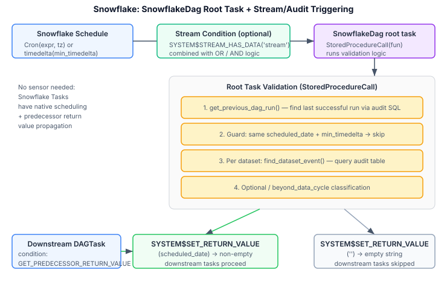
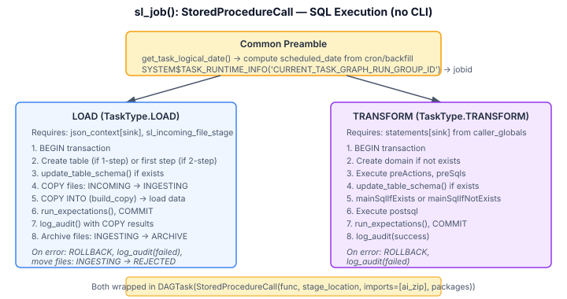

# Starlake Snowflake — Architecture Reference

This document describes the internal architecture of the `starlake-snowflake` module. It is intended for contributors, AI agents, and anyone extending the framework.

For usage documentation, see [README.md](README.md).
For core module architecture, see [starlake-orchestration/ARCHITECTURE.md](../starlake-orchestration/ARCHITECTURE.md).

## Role Within the Framework

The Snowflake module is fundamentally different from Airflow and Dagster: **there is no external orchestrator**. Snowflake Tasks ARE the orchestrator. The Starlake CLI is NOT invoked — instead, load and transform logic runs as **Snowflake Stored Procedures** (Python UDFs) executing SQL directly within Snowflake.

| TypeVar | Snowflake Concrete Type |
|---------|------------------------|
| `U` (pipeline) | `SnowflakeDag` (extends `snowflake.core.task.dagv1.DAG`) |
| `T` (task) | `snowflake.core.task.dagv1.DAGTask` |
| `GT` (task group) | `List[DAGTask]` |
| `E` (event) | `StarlakeDataset` (identity — no separate event type) |

## Package Structure

```
ai.starlake.snowflake/
├── starlake_snowflake_job.py            StarlakeSnowflakeJob, SnowflakeEvent
├── starlake_snowflake_orchestration.py  SnowflakeOrchestration, SnowflakePipeline, SnowflakeDag,
│                                        SnowflakeTaskGroup, SnowflakeTaskResult, SnowflakeDagResult
└── exceptions.py                        StarlakeSnowflakeError
```

Only **one execution environment**: `StarlakeExecutionEnvironment.SQL`. No Shell/Cloud Run/Dataproc/Fargate — everything runs as Snowflake stored procedures.

## Key Architectural Differences from Airflow/Dagster

1. **No Starlake CLI**: `sl_job()` generates `StoredProcedureCall` Python functions that execute SQL directly via Snowpark `Session`, not shell commands. The `statements` and `json_context` dicts (from `caller_globals`) contain the pre-generated SQL to execute.
2. **No external sensor**: Snowflake Tasks have native scheduling (`Cron` or `timedelta`) and predecessor return value propagation (`SYSTEM$GET_PREDECESSOR_RETURN_VALUE`). Dataset validation runs in the **root task** itself.
3. **Stream-based triggering**: Snowflake Streams (`SYSTEM$STREAM_HAS_DATA`) provide CDC-like change detection as an alternative or complement to audit-based validation.
4. **Task group = `List[DAGTask]`**: No native task grouping in Snowflake Tasks — groups are represented as plain lists.
5. **`SnowflakeEvent` is identity**: `to_event()` returns the `StarlakeDataset` unchanged — no conversion to an external event type.

## Pipeline Triggering & Dataset Validation



### How It Works

**1. Schedule**: `SnowflakeDag` is always scheduled — either with a `Cron` expression or a `timedelta(seconds=min_timedelta_between_runs)` fallback. Unlike Airflow/Dagster, there is no "unscheduled" mode.

**2. Stream conditions** (optional): If upstream datasets have associated Snowflake Streams, a `condition` is built:
- Most-frequent dataset streams: combined with `OR` (any change triggers)
- Non-scheduled dataset streams: combined with `AND` (all must have data)
- Mixed: `(stream1 OR stream2) AND (stream3 AND stream4)`

This condition is set on the `SnowflakeDag` root task — Snowflake evaluates it before executing.

**3. Root task validation** (`SnowflakeDag.__init__` → `fun()`):

The root task's `StoredProcedureCall` runs the validation logic as a Python stored procedure within Snowflake:

1. **Baseline**: `get_previous_dag_run()` queries the Starlake audit table for the last successful run
2. **Guard**: if same `scheduled_date` and not manual and not backfill → skip. If manual but within `min_timedelta_between_runs` → skip
3. **Per-dataset validation**: for each tracked dataset (from `least_frequent_datasets`, `not_scheduled_datasets`, `most_frequent_datasets`; only a DAG without schedule tracks datasets, and polls every `min_timedelta_between_runs`):
   - `check_if_dataset_exists()` — verify the dataset table exists
   - Mode and window (see *Data-cycle mode and dataset mode* below): the same rules as Airflow/Dagster, anchored on `scheduled_date`, the latest tick of the DAG's computed cron at or before the logical date (the task graph's `logical_date` configuration, the backfill partition end, or the execution date of the polling run)
   - `find_dataset_event()` — query the **Starlake audit table** (not Snowflake's internal metadata) for a successful run whose scheduled date lies within the window `(min, max]`
4. **Result propagation**:
   - All datasets present → `SYSTEM$SET_RETURN_VALUE(scheduled_date)` (non-empty string), unless a dataset is in data-cycle mode and none has an event scheduled after the scheduled date of the previous successful run (a scheduled run that is not a backfill: see *Behaviour change* below) → `''`
   - Missing datasets → `SYSTEM$SET_RETURN_VALUE('')` (empty string)

**4. Downstream gating**: All downstream `DAGTask` nodes have `condition = "SYSTEM$GET_PREDECESSOR_RETURN_VALUE() <> ''"` set by `start_op()`. This skips the entire pipeline if the root task returned an empty string.

### Data-cycle mode and dataset mode

The data cycle is set only when `data_cycle_enabled` is true: declared by the `data_cycle` option (a preset such as `monthly`, or a cron), or by default the DAG's computed cron. Each tracked dataset is checked in one of two modes:

- **Data-cycle mode** (since 0.4.3, only with a **declared** data cycle, issue #167): a dataset with a cron of its own that fires at least once in **every** period `(tick, next tick]` of the data cycle delivers its data over the period, its ticks being attempts of one delivery (`0 6 1-3 * *`, a monthly delivery whose files arrive on any of the first three days, in a DAG with `data_cycle: monthly`), or one delivery per period (a monthly table `0 6 2 * *` in the same DAG). Its window is `(start of the data-cycle period that holds scheduled_date, scheduled_date]` (`data_cycle_window`, starlake-orchestration): the period start is the latest data-cycle tick strictly before `scheduled_date`, so a `scheduled_date` exactly on a tick belongs to the period that ends there. Freshness widens this window on neither side, and neither *optional* nor *beyond-data-cycle* applies. With `data_cycle: monthly` (`0 0 1 * *`) and `0 6 1-3 * *` dependencies, the run anchored on 2 December 06:00 looks them up in `(1 December 00:00, 2 December 06:00]` (a file of 1 December is accepted), the run anchored on 1 December 06:00 in `(1 December 00:00, 1 December 06:00]` (the delivery of 2 November is refused, whatever the freshness). There is no trigger to catch up on a past period: a run for October needs a logical date in October (the task graph's `logical_date` configuration, or a backfill), after which the same window applies, `(1 October 00:00, 2 October 06:00]` for a logical date of 2 October 06:00.
- **Dataset mode**, as before, for any other dataset: one that misses a period (a yearly table in a monthly cycle, weekdays in a daily cycle), one that fires only on the cycle ticks (`0 0 1 * *` in a monthly cycle, or the declared cycle itself: an event dated on a tick closes the period that ends there, so it would never fall in the window of an anchor that follows the tick), a dataset without a cron of its own, and every dataset when the data cycle is not declared (it then defaults to the DAG's computed cron, which carries the hour of one dependency's cron and delimits no delivery: daily loads at 06:00 and 07:00 would otherwise refuse each other's events of the same day). The window comes from the dataset's own cron, `scheduled_dates_range(cron, scheduled_date)` (for a most frequent cron that does not start at midnight and is not sub-daily, from the next tick after the midnight of `scheduled_date`), its upper bound raised to `scheduled_date`; a dataset without a cron uses the data cycle when there is one, starting no earlier than the previous successful run, and otherwise `(previous successful run - freshness, scheduled_date + freshness]`. Two comparisons with the data cycle apply:
  - **Optional** (`optional_dataset_enabled`): the dataset is skipped when it refreshes less often than the data cycle;
  - **Beyond-data-cycle** (`beyond_data_cycle_enabled`): the window is extended by ±freshness seconds when the dataset's period + freshness exceeds the data cycle's.

  Both use `get_cron_frequency`, which measures the gap between the next two ticks from the wall clock, so for monthly crons their outcome can change with the month the root task runs in; the data-cycle mode removes this for the datasets it covers.

**Where the mode is decided.** The root task runs as an anonymous stored procedure: snowpark pickles its function (`fun`, a closure of `SnowflakeDag.__init__`) with cloudpickle when the DAG is deployed, and the procedure resolves what the pickle references by name from its packages and from the `ai` zip of `zip_selected_packages()` (`ai.starlake.common` and `ai.starlake.helper`; neither `ai.starlake.job` nor `ai.starlake.snowflake` is shipped). The mode is therefore decided at **DAG build time**: `SnowflakePipeline` hands the job's rule, `IStarlakeJob.data_cycle_mode(cron)` (the data cycle is declared, `data_cycle_declared`, and `fires_in_every_period(cron, data_cycle)` holds over a fixed reference span, never reading the wall clock), to `SnowflakeDag` as `data_cycle_mode`, which applies it to the tracked datasets and keeps the result in `data_cycle_mode_datasets`, a set of sinks. Only that set and the data cycle cron reach the closure: neither the job nor the rule is serialized, and the stored procedure never walks the periods (it could have to on every poll, the per-process cache of `fires_in_every_period` not being guaranteed to survive between procedure calls). At run time the window is computed by `data_cycle_window`, which the closure references in `ai.starlake.common`, as it already references `is_valid_cron`, `get_cron_frequency` and `scheduled_dates_range`.

**Behaviour change** (starlake-snowflake 0.4.3): a DAG that already declares `data_cycle` with `data_cycle_enabled` sees its datasets that fire in every period of the data cycle checked in the cycle window, without freshness widening. A dependency more frequent than the cycle is satisfied by any of its events since the start of the period (a daily table in a monthly cycle accepts its event of the 1st on the 20th). Nothing changes without `data_cycle_enabled`, or when `data_cycle` is not declared. Since the root task polls instead of consuming events, a new `scheduled_date` within the period accepts the events of the period again: without a guard, a delivery complete on 1 December would run the DAG on 1 December and again on 2 and 3 December (one run per tick of the computed cron `0 6 1-3 * *`, the guard of step 2 skipping only a repeated `scheduled_date`). So, when the DAG has a dataset in data-cycle mode, a scheduled run that is not a backfill is skipped unless a dataset has an event, in its window, scheduled after the scheduled date of the previous successful run (the end of the period of the computed cron that holds its `SCHEDULED_TIME`, as step 2 computes it): a later attempt of the delivery runs the DAG again, as an orchestrator triggered by events would. The comparison is made in the audit query, like the windows: the record times are not compared, since the audit `TIMESTAMP` is the start of a load written by Starlake core and is stored without time zone, so a reload of an attempt already processed does not run the DAG again. A manual run or a backfill is not guarded, nor is a DAG whose datasets are all in dataset mode. `get_previous_dag_run` reads up to 10,000 rows of `TASK_HISTORY` (100 by default, which a DAG polling every 15 minutes exhausts within a day); beyond the 7 days that `TASK_HISTORY` covers, the previous run is not found and neither this guard nor the one of step 2 applies. The same release fixes the *optional* skip, which crashed the root task (`'str' object has no attribute 'uri'`).

### ALL-only: `dataset_triggering_strategy` has no effect

`DatasetTriggeringStrategy` is never consulted anywhere in starlake-snowflake: setting the `dataset_triggering_strategy` job option to `any` or `all` produces a **structurally identical** Snowflake DAG. The trigger mechanics are fixed by design:

- The stream condition connectives are hard-wired (`OR` across most-frequent scheduled streams, `AND` across not-scheduled streams — step 2 above), independent of the option.
- The root task's per-dataset validation (step 3) skips the run if **any** depended-upon dataset was not published within the window frame — hard-wired ALL semantics.

This is by orchestrator design (see issue [#79](https://github.com/starlake-ai/starlake-orchestration/issues/79)): Snowflake has no event-based triggering mechanism, so ANY cannot and will not be implemented — the run must ensure all depended-upon datasets were published within the window frame. **Snowflake is ALL-only.** A parity pin test (`tests/snowflake/test_snowflake_triggering_strategy.py`) protects this behavior; if the platform ever gains an event mechanism and the ruling is revisited, that pin will flip loudly.

### Comparison with Airflow/Dagster

| Aspect | Airflow | Dagster | Snowflake |
|--------|---------|---------|-----------|
| Trigger mechanism | `ShortCircuitOperator` (runtime) | `MultiAssetSensorDefinition` (polling) | Root task `StoredProcedureCall` (scheduled) |
| Dataset event source | `DatasetEvent` DB table (SQLAlchemy) | `AssetMaterialization` (public API) | Starlake audit table (SQL) + Snowflake Streams |
| Skip mechanism | ShortCircuit skips downstream | `SkipReason` prevents `RunRequest` | Empty `SYSTEM$SET_RETURN_VALUE` + condition check |
| Schedule fallback | None (cron or dataset-only) | None (cron or sensor-only) | `timedelta` (always scheduled) |
| `dataset_triggering_strategy` | ANY/ALL honored (timetable condition) | ANY/ALL honored (trigger gate; post-gate check still requires all) | **Ignored — ALL-only by design** |

## Task Execution: `sl_job()` as StoredProcedureCall



Unlike Airflow/Dagster where `sl_job()` invokes the Starlake CLI, the Snowflake module executes **SQL directly** within Snowflake via stored procedures. The SQL statements come from the calling module's globals (`statements`, `json_context`), which are generated by `starlake dag-generate`.

### TRANSFORM execution

`sl_job()` creates a `StoredProcedureCall` wrapping a Python function that:
1. Resolves `logical_date` from `get_task_logical_date()` or backfill partition info (`SYSTEM$TASK_RUNTIME_INFO`)
2. Computes `sl_data_interval_start`/`sl_data_interval_end` from cron or backfill
3. Within a BEGIN/COMMIT transaction:
   - Creates domain if not exists
   - Executes `preActions`, `preSqls`
   - `update_table_schema()` for schema evolution
   - `mainSqlIfExists` or `mainSqlIfNotExists` (the core transform SQL)
   - SCD2 column additions if needed
   - `postsql` post-processing
   - `run_expectations()` for data quality
4. Logs to audit table via `log_audit()`
5. On error: ROLLBACK + error audit

### LOAD execution

`sl_job()` creates a `StoredProcedureCall` that:
1. Same logical_date/cron resolution
2. Supports 1-step or 2-step loading (controlled by `statements['steps']`)
3. Within a transaction:
   - Creates table, updates schema
   - `copy_files()`: INCOMING → INGESTING (moves files between Snowflake stages)
   - `build_copy()`: generates and executes `COPY INTO` command
   - For 2-step: second step handles SCD2, schema evolution, merge logic
   - `run_expectations()`, post-SQL
4. Audit logging with COPY result metrics (rows_parsed, rows_loaded, errors_seen)
5. On success: archive files (INGESTING → ARCHIVE)
6. On error: ROLLBACK + reject files (INGESTING → REJECTED)

### Key helper classes

Both LOAD and TRANSFORM use helper classes from `ai.starlake.helper`:
- `SnowflakeTaskHelper` / `SnowflakeLoadTaskHelper` — provide SQL execution, audit logging, schema management, expectations
- `SnowflakeDAGHelper` — provides `get_previous_dag_run()`, `find_dataset_event()`, `get_dag_logical_date()` for root task validation
- `zip_selected_packages()` — packages the `ai` module as a zip for upload to Snowflake stage (`imports=[(ai_zip, 'ai')]`)

## Class Reference

### `SnowflakeEvent` (extends `AbstractEvent[StarlakeDataset]`)

Identity transform: `to_event(dataset)` → returns `dataset` unchanged. Snowflake has no separate event type.

### `StarlakeSnowflakeJob` (extends `IStarlakeJob[DAGTask, StarlakeDataset]`, `StarlakeOptions`, `SnowflakeEvent`)

- `sl_orchestrator()` → `StarlakeOrchestrator.SNOWFLAKE`
- `sl_execution_environment()` → `StarlakeExecutionEnvironment.SQL`
- **Properties**: `stage_location`, `warehouse`, `packages` (croniter, python-dateutil, snowflake-snowpark-python + custom), `allow_overlapping_execution`, `sl_incoming_file_stage`, `ai_zip`
- `dummy_op()` — `DAGTask(definition="select '{task_id}'")`
- `start_op()` — delegates to parent but adds `condition = "SYSTEM$GET_PREDECESSOR_RETURN_VALUE() <> ''"` for downstream gating
- `skip_or_start_op()` — `DAGTask` with `StoredProcedureCall` that reads predecessor return value via `TaskContext.get_predecessor_return_value()` and raises `ValueError` on failure
- `sl_load()` — if `run_dependencies_first`, returns a dummy task (actual loading handled by dependency pipeline). Otherwise adds `sink` kwarg and delegates.
- `sl_transform()` — adds `sink` kwarg and delegates
- `sl_job()` — the core method: creates `DAGTask(StoredProcedureCall(...))` for LOAD or TRANSFORM. Only these two task types are implemented; others raise `NotImplementedError`.

### `SnowflakeDag` (extends `snowflake.core.task.dagv1.DAG`)

Custom DAG class that wraps the validation logic into the root task's `StoredProcedureCall`. Constructor parameters include all dataset lists, scheduling config, and stream/audit validation setup, plus `data_cycle_mode`, the job's rule that chooses the data-cycle mode of a dataset from its cron (`None`, the default, checks every dataset in dataset mode); it is applied at build time and never serialized, and `data_cycle_mode_datasets` exposes the sinks it selected (see *Data-cycle mode and dataset mode*). The `_to_low_level_task()` method converts to a standard Snowflake `Task` for deployment.

`condition` (the stream trigger condition) is a property with a setter: `snowflake-core` >= 1.13 assigns `DAG.condition` in `DAG.__init__`, which a read-only property rejects (issue #160). The constructor sets the computed condition after `super().__init__()`, so the root task deploys it with both SDK generations.

### `SnowflakePipeline` (extends `AbstractPipeline[SnowflakeDag, DAGTask, List[DAGTask], StarlakeDataset]`)

- **Constructor**: creates `SnowflakeDag` with schedule, datasets, streams, and validation config (including `data_cycle_mode=job.data_cycle_mode`). DAG dependency wiring uses `upstream.add_successors(downstream)`.
- **Context manager**: pushes/pops `_dag_context_stack` (Snowflake's internal DAG context)
- **`deploy()`** — creates Snowflake stage, then `DAGOperation.deploy(dag, mode=or_replace)` via Snowpark
- **`delete()`** — `DAGOperation.delete(pipeline_id)`
- **`run()`**:
  - `DRY_RUN`: calls each `StoredProcedureCall.func(session, dry_run=True)` locally
  - `RUN`: suspends task → sets CONFIG → resumes → executes → polls `INFORMATION_SCHEMA.TASK_HISTORY()` until completion
  - `BACKFILL`: delegates to RUN mode
- **`backfill()`** — if `allow_overlapping_execution` and no streams: calls `SYSTEM$TASK_BACKFILL()` stored procedure with partition range. Otherwise falls back to parent's croniter-based loop.

### `SnowflakeTaskGroup` (extends `AbstractTaskGroup[List[DAGTask]]`)

Simple wrapper — Snowflake has no native task grouping, so groups are `List[DAGTask]`.

### `SnowflakeOrchestration` (extends `AbstractOrchestration[SnowflakeDag, DAGTask, List[DAGTask], StarlakeDataset]`)

- `sl_orchestrator()` → `StarlakeOrchestrator.SNOWFLAKE`
- `sl_create_task()` — assigns `task._dag = pipeline.dag`. For lists (task groups), creates `SnowflakeTaskGroup` and recursively visits with predecessor wiring.
- `sl_create_task_group()` — returns `SnowflakeTaskGroup(group_id, group=[])`
- `from_native()` — `List` → `SnowflakeTaskGroup`, `DAGTask` → `AbstractTask`

### `SnowflakeTaskResult` / `SnowflakeDagResult`

Runtime status tracking for `run()` mode — tracks task states (EXECUTING, SUCCEEDED, FAILED, SKIPPED) by polling `INFORMATION_SCHEMA.TASK_HISTORY()`.

### `StarlakeSnowflakeError`

Base exception with `message` and `error_code` properties.

## Public API Exports

**`ai.starlake.snowflake`**: `StarlakeSnowflakeJob`, `SnowflakeOrchestration`, `StarlakeSnowflakeError`
